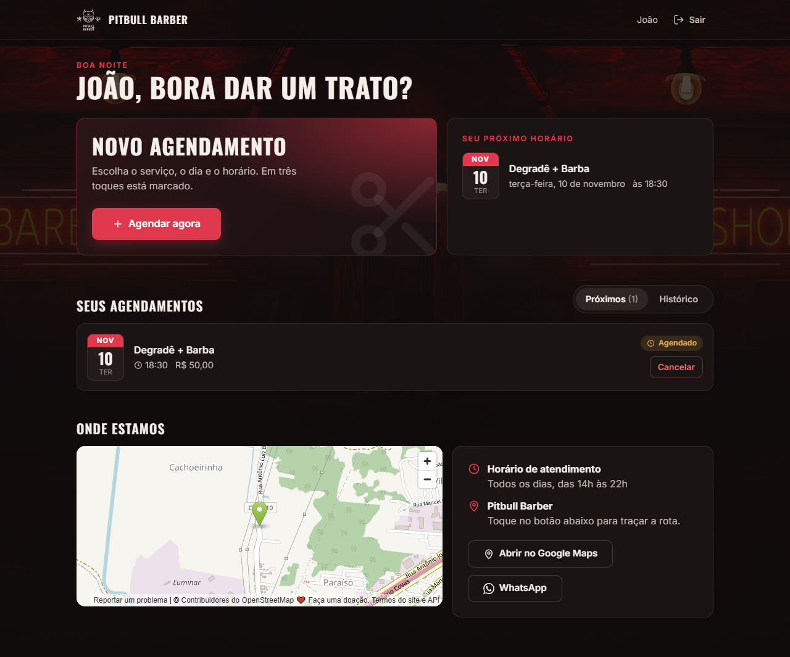
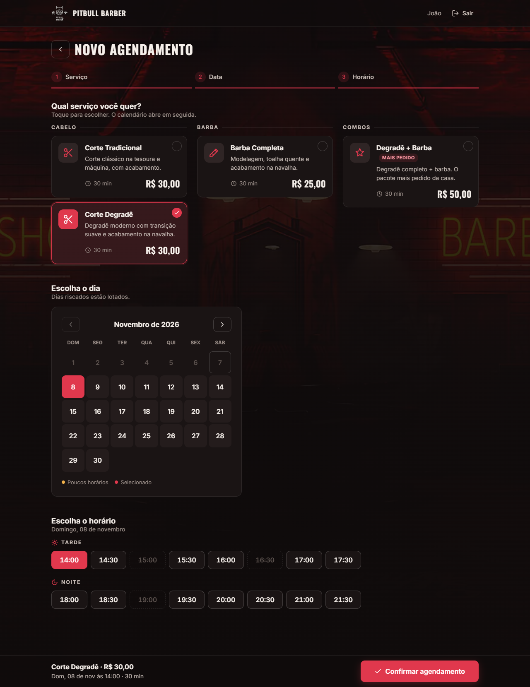
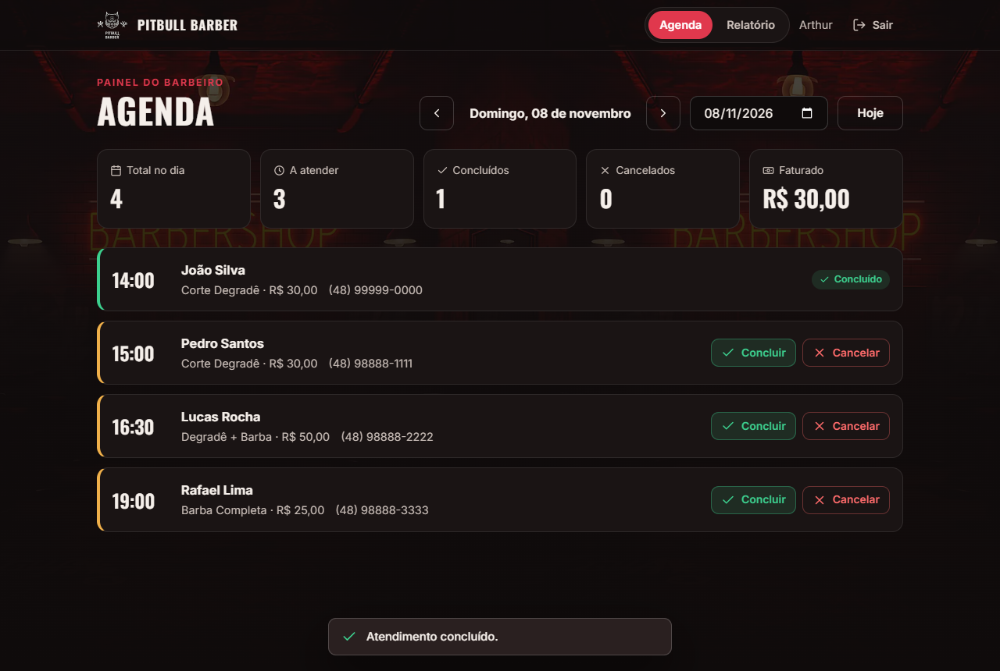
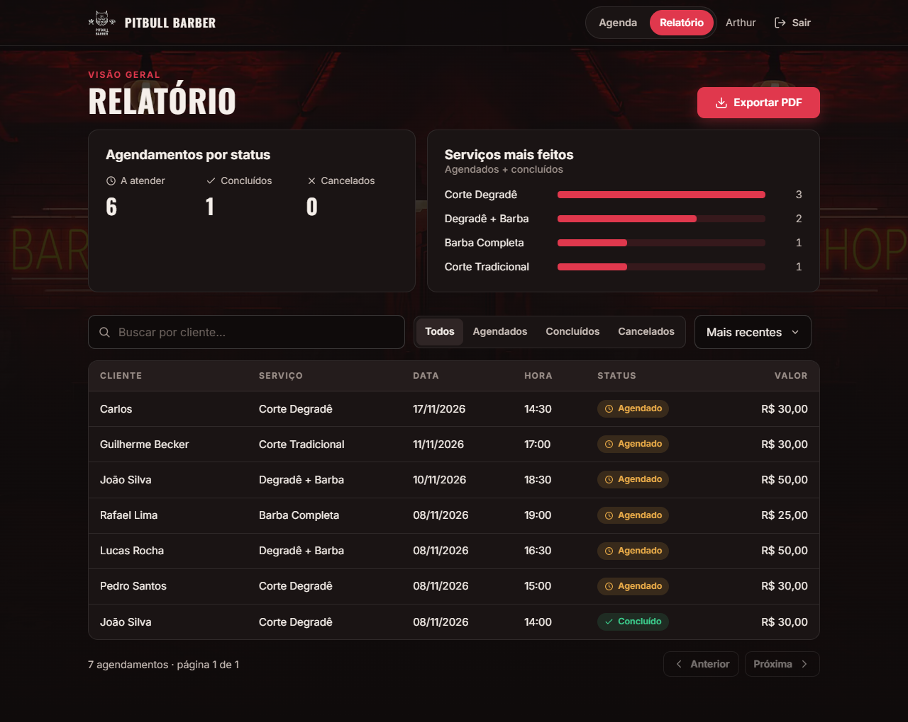
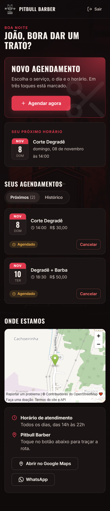
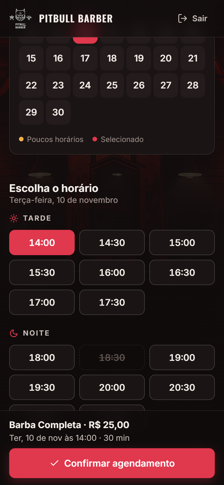
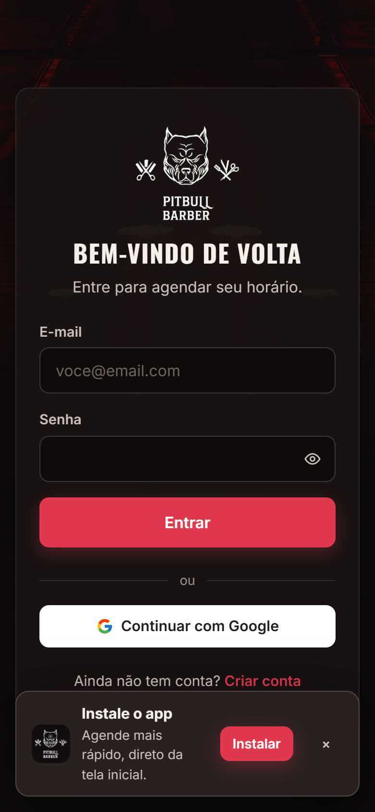
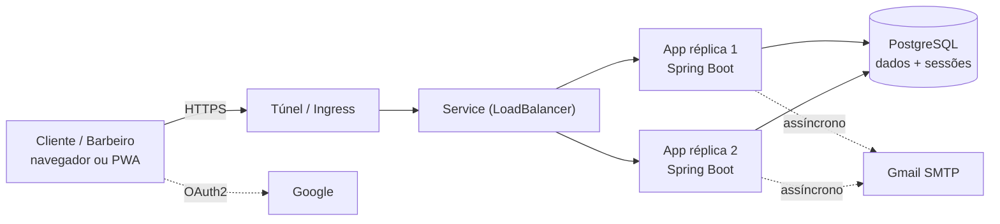

<p align="center">
  
</p>

<h1 align="center">Pitbull Barber — Sistema de Agendamento</h1>

<p align="center">
  Agendamento online para barbearia: o cliente escolhe serviço, dia e horário em três toques;
  o barbeiro acompanha a agenda do dia e os relatórios. Funciona no navegador e instala no celular como app (PWA).
</p>

<p align="center">
  
  
  
  
  
  
</p>

---

## Telas

| Cliente — início | Novo agendamento |
|---|---|
|  |  |

| Admin — agenda do dia | Admin — relatório |
|---|---|
|  |  |

| Celular — início | Celular — horários | Celular — instalar app |
|---|---|---|
|  |  |  |

Mais telas em [`docs/imagens/`](docs/imagens/).

## Funcionalidades

**Cliente**
- Cadastro (já entra logado) ou login com e-mail/senha ou **Google**.
- **Novo agendamento** em destaque no topo; logo abaixo, *Próximos* e *Histórico*.
- Fluxo guiado: escolher o serviço **abre o calendário**; escolher o dia **abre os horários livres** (tarde/noite).
- Dias lotados riscados, dias com poucos horários sinalizados, resumo fixo com botão *Confirmar*.
- Cancelamento pelo próprio cliente (o horário volta a ficar livre) e e-mail de confirmação.
- Mapa da barbearia, atalho para Google Maps e WhatsApp.

**Barbeiro / admin**
- Agenda por dia com resumo (total, a atender, concluídos, cancelados, faturado).
- Concluir ou cancelar atendimentos, com WhatsApp do cliente a um toque.
- Relatório com busca por cliente, filtro por status, ordenação, ranking de serviços e **exportação em PDF**.

**Plataforma**
- **PWA**: instala no celular, abre instantâneo (cache) e tem tela offline.
- Roda com **várias réplicas** (sessões no PostgreSQL), pronto para **Docker** e **Kubernetes**.

## Arquitetura (resumo)



Front **SPA** (JavaScript puro, sem build) servido pelo próprio Spring Boot e consumindo uma **API REST JSON**
organizada em módulos (`auth`, `agendamento`, `servico`, `admin`, `notificacao`).
Detalhes em **[docs/ARQUITETURA.md](docs/ARQUITETURA.md)** e diagramas UML em **[docs/UML.md](docs/UML.md)**.

## Como rodar

### 1. Local (desenvolvimento)
Requisitos: **JDK 21** e **PostgreSQL** com um banco `barbearia`.

```bash
cp segredos.properties.example segredos.properties   # preencha senha do banco, Gmail, Google...
./mvnw spring-boot:run
```
Acesse http://localhost:8080 — as migrations Flyway criam as tabelas e os serviços iniciais.

### 2. Docker
```bash
cp .env.example .env        # preencha as senhas
docker compose up -d --build
```
Acesse http://localhost:8090.

### 3. Kubernetes
```bash
docker build -t pitbull-barber:1.3 .
# crie o Secret "pitbull-segredos" (comando completo em docs/DEPLOY.md)
kubectl apply -k k8s/
```
Passo a passo, acesso externo HTTPS e operação: **[docs/DEPLOY.md](docs/DEPLOY.md)**.

### Testes
```bash
./mvnw test
```

## Documentação

| Documento | Conteúdo |
|---|---|
| [docs/ARQUITETURA.md](docs/ARQUITETURA.md) | visão geral, módulos, front, segurança, performance, implantação, decisões |
| [docs/UML.md](docs/UML.md) | diagramas de classes, sequência, estados, casos de uso e modelo de dados (ER) |
| [docs/API.md](docs/API.md) | todos os endpoints REST com exemplos |
| [docs/DEPLOY.md](docs/DEPLOY.md) | Docker, Kubernetes, túnel HTTPS e operação |
| [docs/JWT.md](docs/JWT.md) | variante de autenticação stateless com JWT (profile `jwt`) |

Com o app rodando, a documentação interativa da API fica em `/swagger-ui/index.html`.

## Stack

Java 21 · Spring Boot 3.4 (Web, Security, OAuth2 Client, Data JPA, Session JDBC, Mail, Actuator) ·
PostgreSQL + Flyway · OpenPDF · SpringDoc OpenAPI · JavaScript (ES modules) · Docker · Kubernetes · Cloudflare Tunnel.

## Segurança

Nenhum segredo fica no repositório: localmente eles ficam em `segredos.properties` (ignorado pelo git);
em Docker/Kubernetes, em variáveis de ambiente e `Secret`. Veja a seção de segurança em
[docs/ARQUITETURA.md](docs/ARQUITETURA.md#4-segurança).
