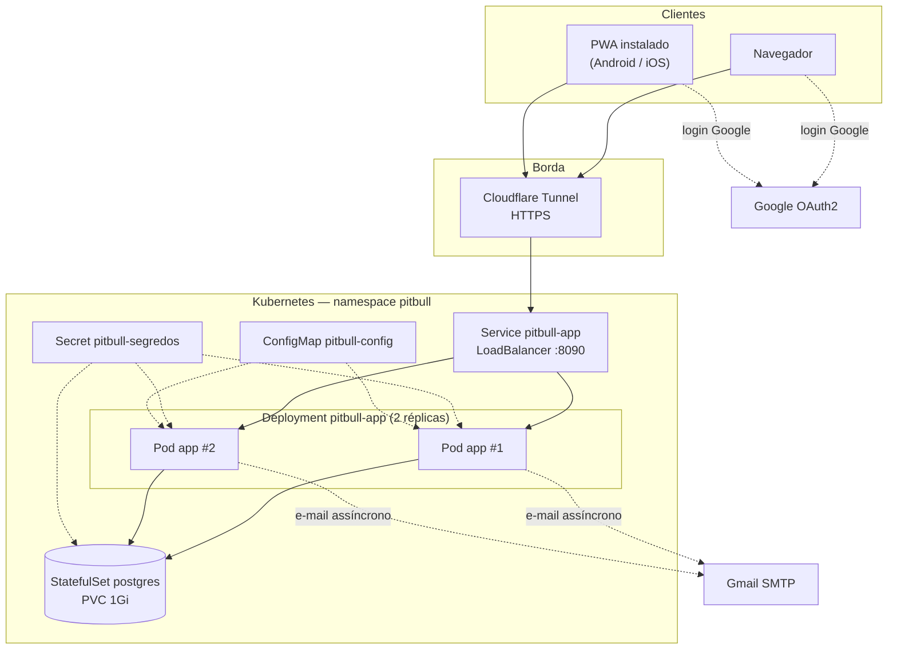
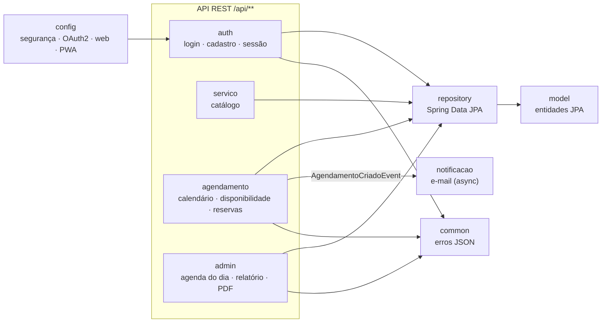
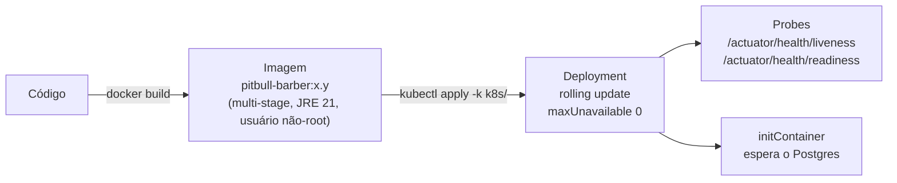

# Arquitetura — Pitbull Barber

## 1. Visão geral

Sistema **distribuído em duas camadas** — um front-end SPA/PWA e uma API REST — implantado como
várias réplicas stateless atrás de um balanceador, com o estado (dados e sessões) no PostgreSQL.



### Por que front + API (e não microserviços)?

| Critério | Front + API modular (escolhido) | Microserviços |
|---|---|---|
| Fluidez para o usuário | Igual — vem da SPA (sem recarregar página) | Igual |
| Custo para rodar | 1 imagem, 1 banco | Gateway + N serviços + rede entre eles |
| Consistência do agendamento | Uma transação no banco | Coordenação distribuída (sagas) |
| Escala | Réplicas horizontais (sessão no banco) | Escala por serviço |
| Evolução | Módulos com fronteiras claras: dá para extrair um serviço depois sem reescrever o front | — |

Os módulos conversam por **serviços e eventos** (ex.: `AgendamentoCriadoEvent` → `notificacao`),
o que já deixa o caminho pronto caso algum deles precise virar um serviço separado.

## 2. Backend — módulos



| Pacote | Responsabilidade | Principais classes |
|---|---|---|
| `auth` | Login por senha, cadastro, sessão, conta Google; migra senhas antigas para BCrypt no 1º login | `AuthApiController`, `AuthService`, `SessaoService` |
| `servico` | Catálogo de serviços (cache de 5 min no navegador) | `ServicoApiController` |
| `agendamento` | Regras de agenda, calendário, disponibilidade, reserva e cancelamento | `AgendaPolicy`, `AgendamentoService`, `AgendamentoApiController` |
| `admin` | Agenda do dia, concluir/cancelar, relatório filtrado no banco, PDF | `AdminService`, `AdminApiController`, `RelatorioPdf` |
| `notificacao` | E-mail de confirmação **depois do commit e fora da requisição** | `NotificacaoListener`, `EmailService` |
| `common` | Erros padronizados `{"erro": "..."}` com o status HTTP certo | `ApiExceptionHandler`, `RegraNegocioException` |
| `config` | Segurança, OAuth2, rotas antigas, cache/MIME, senha do admin por ambiente | `SecurityConfig`, `OAuth2LoginSuccessHandler`, `WebConfig` |
| `util` | Limpeza mensal de agendamentos com mais de 1 ano | `LimparAgendamento` |

### Regras de negócio da agenda (`AgendaPolicy`)
- Atendimento das **14:00 às 21:30** (último horário), de **30 em 30 min** — 16 horários por dia.
- Reservas a partir de **amanhã** e até **60 dias** à frente.
- Um horário só tem **um agendamento ativo** (cancelados liberam o horário). Garantido também no banco
  por índice único parcial (`V14`), o que resolve cliques simultâneos (retorna `409`).
- O cliente só cancela agendamentos **futuros** e **ainda agendados**.

## 3. Front-end — SPA + PWA

Sem framework e sem etapa de build: **ES modules** nativos servidos de `src/main/resources/static/`.

```
static/
├── index.html              shell do app (carrega main.js)
├── manifest.webmanifest    PWA: nome, ícones, cores, atalho "Agendar"
├── sw.js                   service worker (cache do app + tela offline)
├── offline.html
├── imagens/                logo, fundo (WebP) e ícones do PWA
└── app/
    ├── main.js             roteador por hash, guarda de rotas, prefetch, PWA
    ├── api.js              cliente HTTP (CSRF, 401 → volta ao login, cache de serviços)
    ├── ui.js               ícones SVG, formatação pt-BR, toasts, diálogo, escape (XSS)
    ├── styles.css          design system (tokens de cor, tipografia, componentes)
    └── views/
        ├── auth.js         entrar / cadastro
        ├── inicio.js       início do cliente
        ├── agendar.js      fluxo serviço → calendário → horário → confirmar
        ├── admin.js        agenda do dia
        └── relatorio.js    relatório e PDF
```

| Rota | Tela | Acesso |
|---|---|---|
| `#/entrar`, `#/cadastro` | Login e cadastro | público |
| `#/inicio` | Novo agendamento + próximos/histórico + localização | cliente |
| `#/agendar` | Fluxo de agendamento | cliente |
| `#/admin` | Agenda do dia | admin |
| `#/admin/relatorio` | Relatório | admin |

**UX:** alvos de toque ≥ 44 px, foco visível, navegação por teclado (abas WAI-ARIA), `aria-live` para
mudanças, estados de carregamento (skeleton/spinner), confirmação antes de ações destrutivas,
`prefers-reduced-motion` respeitado, layout mobile-first.

## 4. Segurança

| Tema | Como é tratado |
|---|---|
| Autenticação | Sessão HTTP (cookie `SESSION`, HttpOnly, SameSite=Lax) guardada no PostgreSQL (Spring Session JDBC) |
| Senhas | BCrypt. Senhas antigas em texto puro são convertidas automaticamente no 1º login |
| Autorização | `/api/admin/**` exige `ROLE_ADMIN`; demais `/api/**` exigem login (401 em JSON) |
| CSRF | Token no cookie `XSRF-TOKEN`, devolvido pelo front no header `X-XSRF-TOKEN` |
| XSS | A API devolve só JSON; o front escapa todo dado antes de exibir (`esc()`) |
| Concorrência | Índice único parcial impede dois agendamentos ativos no mesmo horário |
| Segredos | Fora do repositório: `segredos.properties` (local, ignorado) / variáveis de ambiente / `Secret` do K8s |
| Admin publicado | Senha definida por `ADMIN_SENHA` no ambiente (sobrescreve a semente da migration `V12`) |
| Proxy HTTPS | `server.forward-headers-strategy=framework` (links e OAuth corretos atrás do túnel) |

> ⚠️ Versões antigas deste repositório tiveram a senha de app do Gmail commitada
> (`application.properties`). Ela deve ser **revogada** na conta Google e substituída por uma nova,
> configurada só em `segredos.properties` / `Secret`.

## 5. Performance

- SPA: troca de tela sem recarregar; telas carregadas sob demanda (`import()`) e **pré-carregadas** após o login.
- Imagens convertidas para **WebP** (≈ 10 MB → ≈ 100 KB); sem Bootstrap/jQuery.
- **gzip** nas respostas; imagens com cache de 30 dias; JS/CSS revalidados por `Last-Modified`.
- **E-mail assíncrono** (`@Async` + `@TransactionalEventListener`): confirmar agendamento não espera o SMTP.
- Consultas com `@EntityGraph` (sem N+1) e filtros/paginação do relatório feitos no banco.
- PWA: app abre a partir do cache do service worker.

## 6. Dados

Migrations Flyway em `src/main/resources/db/migration` (`V1`–`V15`). Modelo ER completo em
[UML.md](UML.md#modelo-de-dados-er).

| Migration | O que faz |
|---|---|
| V1–V10 | Tabelas base (clientes, permissões, serviços, funcionários, usuários, agendamentos, chegada, tempo de atendimento, log de acessos) |
| V11–V13 | Perfis USER/ADMIN, admin inicial, 4 serviços |
| V14 | Categoria e descrição dos serviços; telefone opcional (login Google); índice único de horário ativo |
| V15 | Tabelas do Spring Session (sessões compartilhadas entre réplicas) |

## 7. Implantação



- **Rolling update sem downtime** (`maxUnavailable: 0`) e probes de liveness/readiness/startup.
- `initContainer` aguarda o PostgreSQL antes de subir o app.
- Acesso externo HTTPS por **Cloudflare Tunnel** (necessário para instalar o PWA).
- Passo a passo em [DEPLOY.md](DEPLOY.md).

## 8. Variante JWT (opcional)

Para clientes não-navegador (ex.: app nativo), existe uma configuração stateless com JWT ativada pelo
profile `jwt` (`SecurityConfigJwt`, `JwtAuthenticationFilter`, `/barbearia/api/auth/**`). Veja [JWT.md](JWT.md).
