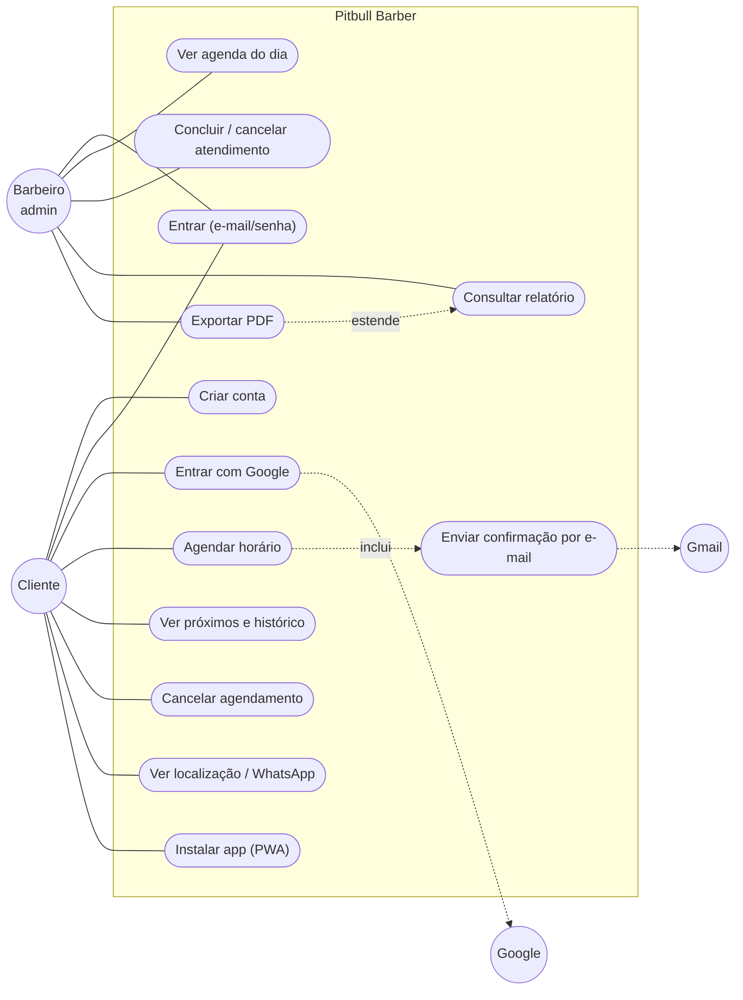
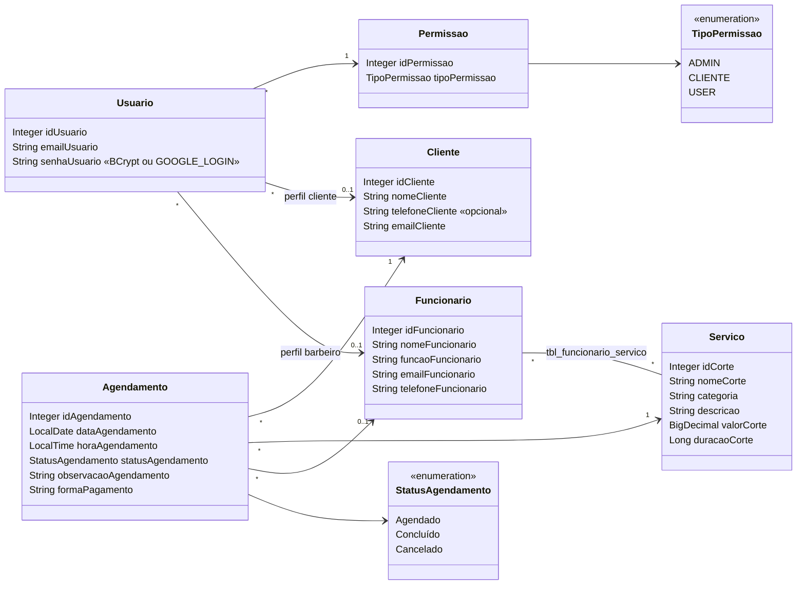
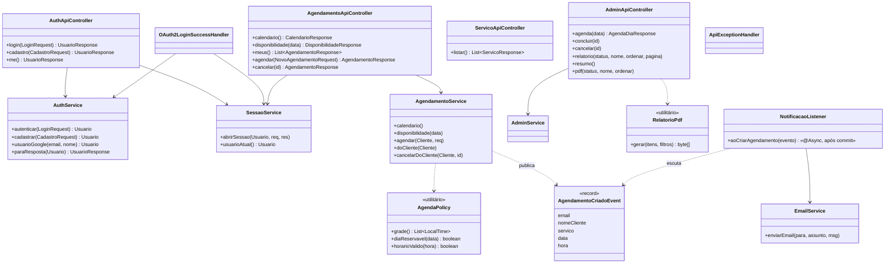
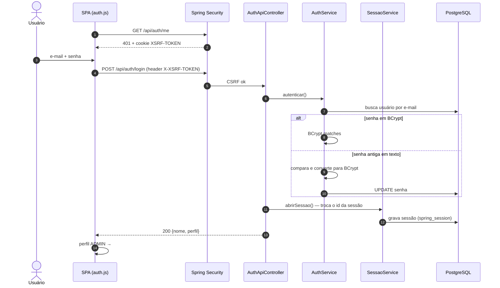
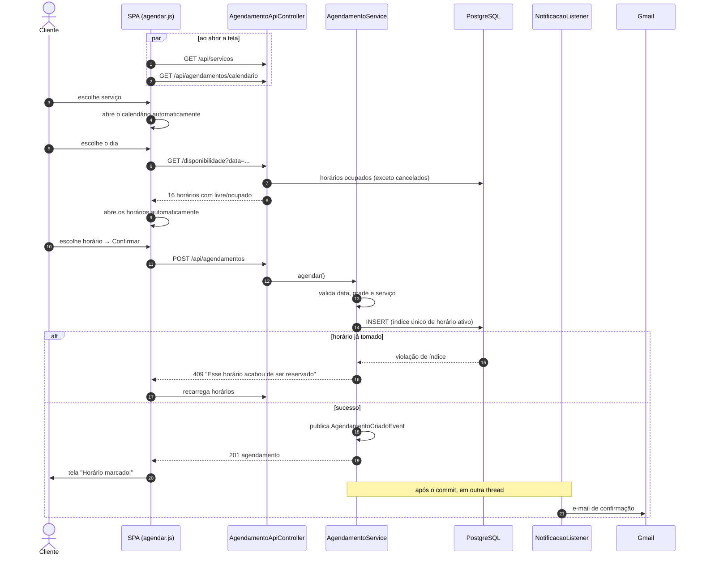
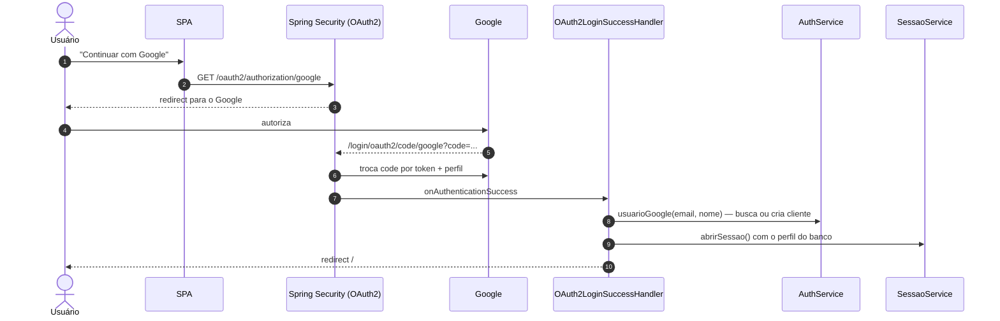
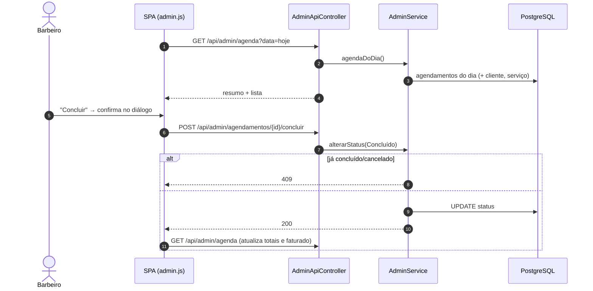
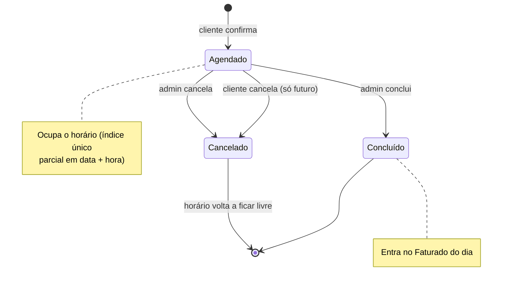
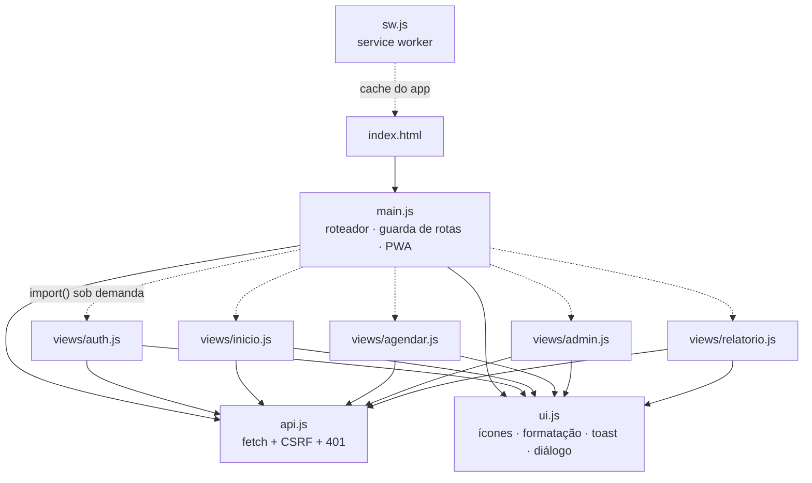
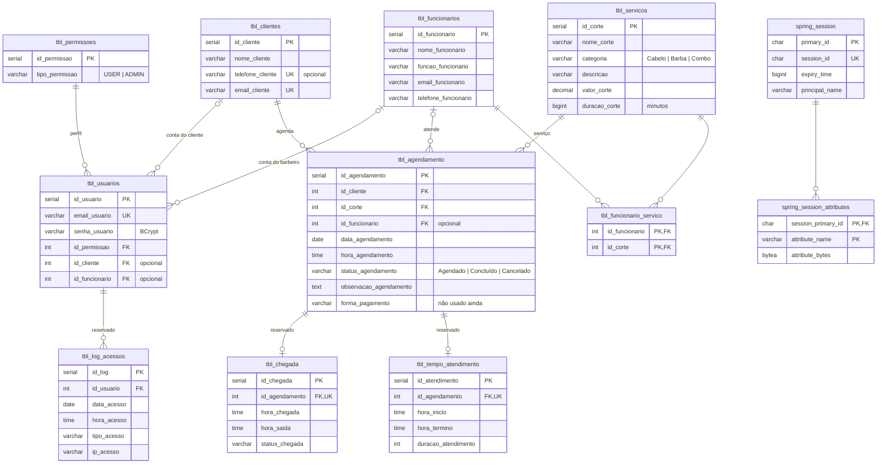

# Diagramas UML — Pitbull Barber

Diagramas em [Mermaid](https://mermaid.js.org/) (o GitHub renderiza direto).

- [Casos de uso](#casos-de-uso)
- [Classes — domínio](#classes--domínio)
- [Classes — serviços da API](#classes--serviços-da-api)
- [Sequência — login](#sequência--login-por-e-mail-e-senha)
- [Sequência — novo agendamento](#sequência--novo-agendamento)
- [Sequência — login com Google](#sequência--login-com-google)
- [Sequência — admin conclui atendimento](#sequência--admin-conclui-atendimento)
- [Estados do agendamento](#estados-do-agendamento)
- [Componentes do front](#componentes-do-front)
- [Modelo de dados (ER)](#modelo-de-dados-er)

---

## Casos de uso

## Classes — domínio

## Classes — serviços da API

## Sequência — login por e-mail e senha

## Sequência — novo agendamento

## Sequência — login com Google

## Sequência — admin conclui atendimento

## Estados do agendamento

## Componentes do front

## Modelo de dados (ER)

> Índice único parcial `ux_agendamento_horario_ativo` em `tbl_agendamento (data_agendamento, hora_agendamento)
> WHERE status_agendamento <> 'Cancelado'`. As tabelas marcadas "reservado" existem no banco para
> evoluções futuras (check-in, tempo de atendimento, auditoria) e ainda não são usadas pelo código.
